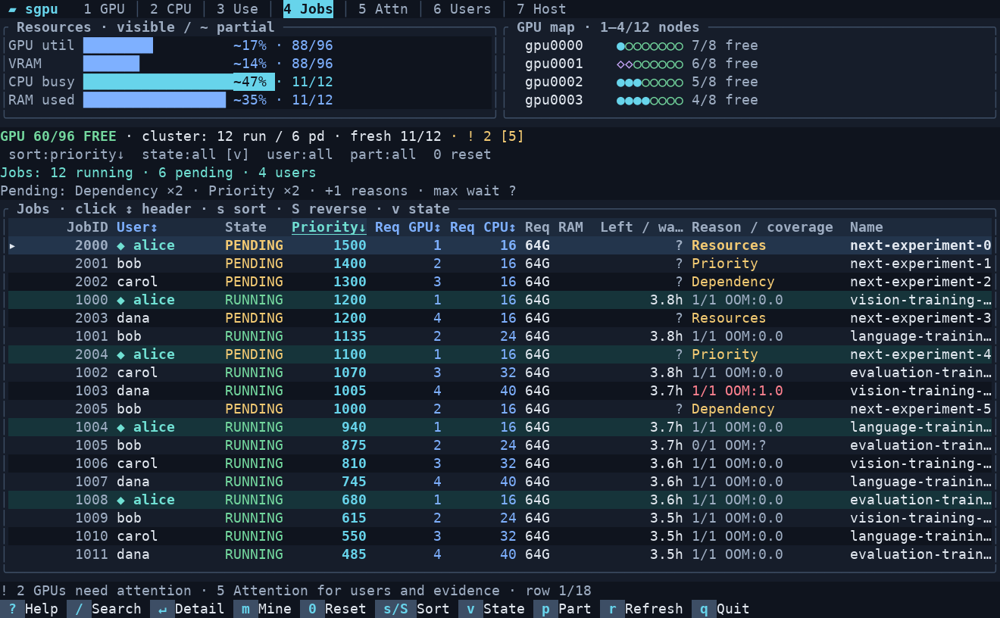
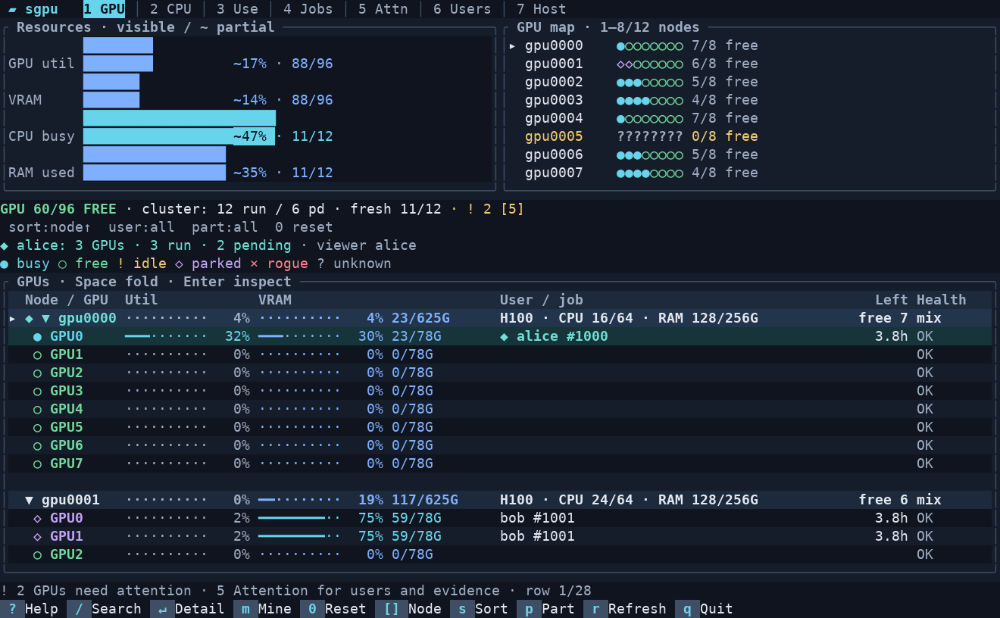
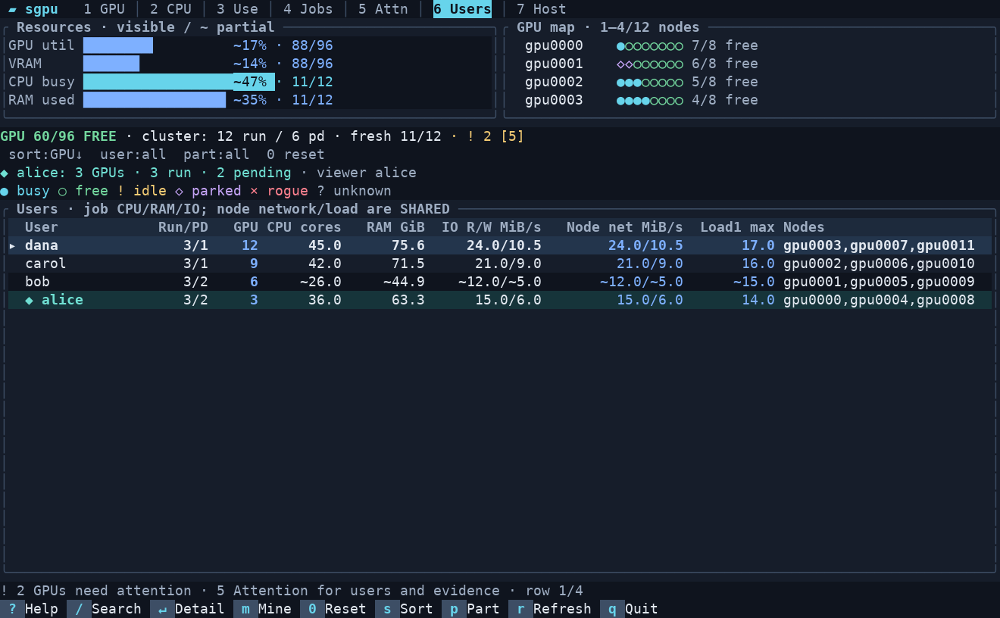

<div align="center">

# Oh My Slurm

**Monitoring, diagnostics, and everyday tools for Slurm clusters.**

GPU · CPU · RAM · Jobs · People · Alerts

[](https://github.com/eightmm/oh-my-slurm/actions/workflows/test.yml)
[](https://github.com/eightmm/oh-my-slurm/blob/main/Cargo.toml)
[](#build-and-install)

[Screenshots](#screenshots) · [Install](#build-and-install) · [Usage](#usage) · [Guides](#guides) · [한국어](docs/README.ko.md)

</div>

An independent community toolkit, formerly `slurm-gpu-tui`. The dashboard command
remains `sgpu`; existing `chk*` commands, settings and installation paths stay compatible.

| See the cluster | Inspect work | Keep it running |
|---|---|---|
| Live resource meters, node maps and capacity | Priority sorting, user views, logs and own-job cancellation | GPU waste, usage history, Slack alerts and Prometheus metrics |

## Screenshots



*Rendered with synthetic demo data at 120 columns.*

<details>
<summary>More views: GPU · Users · Host · 80-column Jobs</summary>






</details>

## Build and install

```bash
curl -fsSL https://raw.githubusercontent.com/eightmm/oh-my-slurm/refs/heads/main/bootstrap.sh | sudo bash
```

Run on the master as root. Requires Linux, git and a C compiler; Rust is prepared
when needed. Run again to upgrade while keeping existing paths, state and Slack
settings. The same command publishes and verifies node-agent updates, including
legacy-agent migration using existing administrative SSH access. Failed nodes
are listed and make the command exit unsuccessfully. Users run `sgpu`.

Nodes publish to a shared filesystem. See [node setup and upgrade requirements](docs/PUSH.md)
for shared paths, root SSH or remote sudo, and architecture compatibility.
Use `--local-only` to update only the controller without publishing node updates.

## Usage

```bash
sgpu                    # Interactive dashboard
chkgpu                  # User × node allocation matrix
chkgpu --summary        # Node headroom and pending reasons
chkqueue --mine         # My pending jobs by priority, wait and reason
chkfail                 # My failures/stops ending in the last 24h
sgpu explain 12345      # Pending facts, interpretation and node headroom
sgpu me                 # My jobs and usage
sgpu users              # Per-user resources
sgpu host               # Controller resources
sgpu usage 7 --daily    # GPU/CPU/RAM usage
sgpu fit 1 --nodes 2    # Multi-node fit (--cpu-only for CPU jobs)
sgpu logs 12345 -e -f   # Follow stderr (with finished-job WorkDir fallback)
sgpu doctor             # Collection, PID, and shared-dir checks
sgpu welcome            # Short login overview, published data only
```

| Control | Action |
|---|---|
| `1`–`8` · `Tab` / `←` / `→` | GPU / CPU / Usage / Jobs / Attention / Users / Host / Partitions |
| Click `↕` · `s` / `S` | Header sorting (all sortable tabs & History) · reverse |
| `u` / `p` / `m` | User / partition / highlighted-account filters |
| `U` / `P` | Search & select a user / partition (`Ctrl+U` or `[×]` clears query) |
| `E` / `F` | Explain pending job / my 24h failure report |
| `v` (Jobs / Usage) · `D` | Jobs: all / running / pending · Usage: user / daily · window 7d / 14d / 30d |
| `h` (History popup) | Filter (`/`) · `s` / `S` / click `↕` sort · `0` reset · 2×click / Enter detail |
| `/` / `Ctrl+U` / `0` | Search (2-bulsik Korean IME) / clear query (`[×]`) / reset filters |
| 2×click / Enter · `1`–`9` / `Tab` | Open detail · switch Summary / Raw / Script / StdOut / StdErr panes |
| Right-click / `a` · `x` | Actions menu (`↑↓`/`Tab` + Enter or hotkey, `a` closes) · cancel own job |
| `J` / Esc | Related Jobs from GPU, CPU, Usage, Users, Attention or Partitions / return |
| `?` / `q` | Full help (or click `sgpu`) / quit |

Use `sgpu --help` for all commands. Structured `--json` output is supported on
`doctor`, `host`, `users`, `me`, `explain`, `waste`, `usage`, `jobs`, `report`,
`fit`, `queue`, and `failures`. Highlight an account with
`sgpu --highlight-user alice`; permissions still follow the executing account. All
three `chk*` commands share `--color auto|always|never`, respect `NO_COLOR`, and
omit colors in pipes by default.
Cyan headings · green own jobs/clear results · yellow waiting/stopped · red failures/full capacity · grey context.
JSON stays uncolored, including with `--color always`.

The last tab, sort and Jobs state are saved in `~/.sgpu/ui/preferences.json`.
Searches, account filters, logs and temporary related views stay in the current session.

Tabs, rows, `sgpu` help, dashboard **Resources** (5m trend) and **GPU map** (click jump, 2×click inspect, right-click actions), summary/filter chips, marked `↕` headers, `[×]` clear buttons and footer controls accept mouse clicks.
Row click selects; double-click or **Detail** opens it, and right-click or `a` opens Actions. Cancel confirmation toggles **Keep** / **Cancel** with `←`/`→`/`Tab`, runs with `Enter`, or acts directly via `y`/`n`/click.
Short detail windows expand to the screen; use the wheel, `↑↓`, `Space`/`b`, `PgUp`/`PgDn`, `g`/`G`, or paging buttons to scroll, and `f` / **Follow** to toggle live log tailing.
Inside details/logs, `/` finds literal text; `n` / `N` move between matching lines. Enter applies, `Ctrl+U` / `[×]` clears input, and Esc clears the search first before closing the popup.

`chkqueue` = `sgpu queue` (`--mine`, `--partition`, `--limit`, `--json`).
`chkfail` = `sgpu failures` (`--hours 24`, `--json`): one owner-only accounting query,
UTC end-time window; cancellations/preemptions are separate, allocation records exclude job steps.
Works with Slurm 19.05 and newer without requiring `sacct --array`; grouped array tasks are expanded locally.

`?` means unavailable, `~` partial coverage. Stale data never counts as free capacity.
GPU Health `CAP` means a power-limit clock adjustment; it is informational on its own.
Network/load in Users are shared-node values. Priority, headroom and start-time
estimates do not guarantee scheduler admission. See [metric interpretation](docs/PUSH.md#resource-views).

## Guides

| Guide | Covers |
|---|---|
| [Node setup and upgrades](docs/PUSH.md) | Shared directories, services, configuration and troubleshooting |
| [Login summaries](docs/LOGIN.md) | Short shared/personal views and optional MOTD integration |
| [Mixed-cluster compatibility](docs/COMPATIBILITY.md) | Slurm versions, GPU/driver fallbacks and native binaries |
| [Performance checks](docs/PERFORMANCE.md) | Replay and large-queue benchmarks |
| [Slack alerts](docs/ALERTS.md) | Bot setup, daily threads and owner DMs |
| [Prometheus metrics](docs/METRICS.md) | Textfile output and alert rules |

The installer shares job-log tails and sanitized job details with snapshot readers
by default. Set `SGPU_SHARE_LOGS=0` / `SGPU_SHARE_JOB_DETAILS=0` to disable; scripts are opt-in.

Checks: `bash scripts/check.sh` · [Issues](https://github.com/eightmm/oh-my-slurm/issues) · [Contribute](https://github.com/eightmm/oh-my-slurm/pulls) · [Star](https://github.com/eightmm/oh-my-slurm/stargazers)
