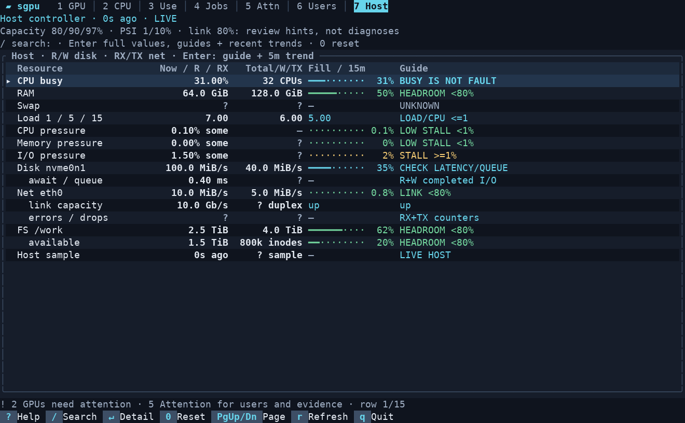
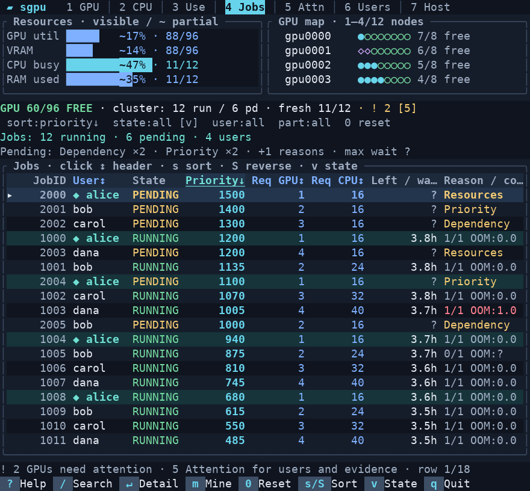

<div align="center">

# sgpu

**Your Slurm GPU cluster, at a glance.**

GPU · CPU · RAM · Jobs · People · Alerts

[](https://github.com/eightmm/slurm-gpu-tui/actions/workflows/test.yml)
[](https://github.com/eightmm/slurm-gpu-tui/blob/main/Cargo.toml)
[](#build-and-install)

[Screenshots](#screenshots) · [Install](#build-and-install) · [Usage](#usage) · [Guides](#guides) · [한국어](docs/README.ko.md)

</div>

| See the cluster | Inspect work | Keep it running |
|---|---|---|
| Live resource meters, node maps and capacity | Priority sorting, user views, logs and own-job cancellation | GPU waste, usage history, Slack alerts and Prometheus metrics |

## Screenshots


*Rendered with synthetic demo data at 120 columns.*

<details>
<summary>More views: GPU · Users · Host · 80-column Jobs</summary>






</details>

## Build and install

```bash
curl -fsSL https://raw.githubusercontent.com/eightmm/slurm-gpu-tui/refs/heads/main/bootstrap.sh | sudo bash
```

Run on the master as root. Requires Linux, git and a C compiler; Rust is prepared
when needed. Run again to upgrade while keeping existing paths, state and Slack
settings. Users run `sgpu`.

Nodes publish to a shared filesystem. Follow the [node setup guide](docs/PUSH.md)
on each node; bootstrapped compatible agents receive [automatic updates](docs/PUSH.md#automatic-agent-updates).

## Usage

```bash
sgpu                    # Interactive dashboard
chkgpu                  # User × node allocation matrix
chkgpu --summary        # Node headroom and pending reasons
sgpu me                 # My jobs and usage
sgpu users              # Per-user resources
sgpu host               # Controller resources
sgpu usage 7 --daily     # GPU-hours
sgpu logs 12345 -e -f    # Follow stderr
sgpu doctor             # Collection checks
```

| Control | Action |
|---|---|
| `1`–`7` | GPU / CPU / Usage / Jobs / Attention / Users / Host |
| Click `↕` · `s` / `S` | Jobs header sorting · cycle sort / reverse |
| `u` / `p` / `m` | User / partition / highlighted-account filters |
| `v` in Jobs | All / running / pending |
| `/` / `0` | Search / reset filters |
| Enter / Tab | Details / script and log tabs |
| `J` / Esc | Related Jobs from GPU, CPU, Users or Attention / return |
| `?` / `q` | Full help / quit |

Use `sgpu --help` for all commands. Highlight an account with `sgpu --highlight-user alice`;
permissions still follow the executing account. `chkgpu` respects `NO_COLOR` and supports `--color always` / `--color never`.

The last tab, sort and Jobs state are saved in `~/.sgpu/ui/preferences.json`.
Searches, account filters, logs and temporary related views stay in the current session.

`?` means unavailable, `~` partial coverage. Stale data never counts as free capacity.
Network/load in Users are shared-node values. Priority, headroom and start-time
estimates do not guarantee scheduler admission. See [metric interpretation](docs/PUSH.md#resource-views).

## Guides

| Guide | Covers |
|---|---|
| [Node setup and upgrades](docs/PUSH.md) | Shared directories, services, configuration and troubleshooting |
| [Slack alerts](docs/ALERTS.md) | Bot setup, daily threads and owner DMs |
| [Prometheus metrics](docs/METRICS.md) | Textfile output and alert rules |

The installer shares job-log tails and sanitized job details with snapshot readers
by default. Set `SGPU_SHARE_LOGS=0` / `SGPU_SHARE_JOB_DETAILS=0` to disable; scripts are opt-in.

Checks: `bash scripts/check.sh` · [Issues](https://github.com/eightmm/slurm-gpu-tui/issues) · [Contribute](https://github.com/eightmm/slurm-gpu-tui/pulls) · [Star](https://github.com/eightmm/slurm-gpu-tui/stargazers)
