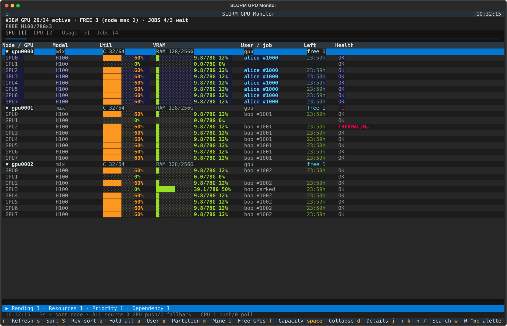

# sgpu

Slurm GPU operations monitor written in Rust: terminal UI, autonomous node
publishers, collector, usage accounting, Slack alerts and Prometheus textfiles.

[한국어](README_ko.md) · [Node setup](docs/PUSH.md) · [Slack](docs/ALERTS.md) · [Metrics](docs/METRICS.md)



## Data flow

```text
node: sgpu-agent --mode gpu   ── every 3s ──┐
node: sgpu-agent --mode cpu   ── every 20s ─┴─> shared <AGENT_DIR>/<hostname>.json
                                                        ↓
master: local Slurm CLI + shared files ──> sgpu-collector ──> data.json / metrics.prom
                                                              ↓
                                                         sgpu terminal UI
```

Each node runs its own service and publishes results independently. Missing,
untrusted or stale results remain unavailable; the collector keeps inventory
without inferring free capacity. Node installation, restart and power setup
are performed locally on that node. The master reads shared files and queries
its local Slurm tools. Job cancellation is routed through the Slurm controller.

## Build and install

Install the Rust version from `main` with curl:

```bash
# On the master, with a publication directory shared by every node:
curl -fsSL https://raw.githubusercontent.com/eightmm/slurm-gpu-tui/main/bootstrap.sh \
  | SLURM_GPU_TUI_AGENT_DIR=/nfs/sgpu-nodes bash -s -- --role master

# Run locally on each GPU node:
curl -fsSL https://raw.githubusercontent.com/eightmm/slurm-gpu-tui/main/bootstrap.sh \
  | SLURM_GPU_TUI_AGENT_DIR=/nfs/sgpu-nodes bash -s -- --role node --mode gpu
# CPU-only nodes use --mode cpu. Run the bash side as root for system services.
```

The bootstrap requires Linux, git and a C compiler/linker. It installs a minimal
Rust 1.93.0 toolchain through [official rustup](https://rust-lang.github.io/rustup/installation/index.html)
when a suitable Rust compiler is unavailable, then builds locked dependencies
and installs native executables. The first build can take several minutes.
`SGPU_INSTALL_RUST=0` disables automatic Rust setup. `SGPU_SOURCE_DIR` selects
the source checkout (default `~/.sgpu/source`); dirty checkouts are preserved
unless `SGPU_FORCE_UPDATE=1` explicitly permits discarding tracked edits.
Existing checkout updates must fast-forward. Re-run the same curl command to
upgrade the local role. Build-only tools are not required for `--no-build`
with `SGPU_BIN_DIR` pointing to compatible prebuilt binaries.

To build from an existing checkout, use Rust 1.93 or newer. The master needs `sinfo`, `squeue`
and `scontrol`; `sacct` supplies history and accounting. GPU nodes need
`nvidia-smi`. Rust is needed only on the build host. Prebuilt executables must
match the target architecture and system C library.

```bash
cargo build --release --locked --bins -j 2

# On the master; select a directory mounted by every publisher and the master.
SLURM_GPU_TUI_AGENT_DIR=/nfs/sgpu-nodes bash install.sh --no-build --role master

# Run locally on EACH GPU node, using binaries available on that host.
SLURM_GPU_TUI_AGENT_DIR=/nfs/sgpu-nodes bash install.sh --no-build --role node --mode gpu
# For CPU-only nodes, use --mode cpu.
```

`SGPU_BIN_DIR` selects a directory containing all five native binaries:
`sgpu`, `sgpu-agent`, `sgpu-collector`, `chkgpu`, `sgpu-install`.
The installer defaults to `/opt/sgpu` for root and `~/.sgpu/app` otherwise;
override with `--prefix` or `SGPU_INSTALL_DIR`. Root installs a system service
and links under `/usr/local/bin`; other users get a user service when available,
otherwise a background daemon, plus a PATH line in `~/.profile`. User services
follow the site's login/linger policy. `--no-service` installs files and rendered
units without changing services, PATH or shared directories.

Upgrades create a versioned release and atomically switch `current`. On failure,
the installer attempts to restore previous files and service state and reports
any restoration error. Previous releases and persistent data are retained.
When upgrading an existing installation, explicitly reuse its prefix and data,
state and agent directories. Node services must be upgraded locally as well.
`bash deploy.sh [install options]` runs the required checks before building
and installing on the current host.

Root master installs default to sharing log tails and sanitized job details;
set `SGPU_SHARE_LOGS=0` / `SGPU_SHARE_JOB_DETAILS=0` to disable them. Script
sharing is opt-in (`SGPU_SHARE_SCRIPTS=1`). Shared scripts and runtime logs may
contain secrets: enable these only where all users may read that content.
Private source log paths are never serialized into snapshots. Reads validate
scheduler numeric UID and regular-file identity; a root reader drops privileges
to the owner, including on root-squashed home directories.

Root GPU-node installation also enables local NVIDIA persistence mode;
`SGPU_ENABLE_PERSISTENCE=0` skips it. Optional local power setup:
`bash setup-node-power.sh --check` or, as root on that node,
`bash setup-node-power.sh --apply`.

Uninstall the role on its own host:

```bash
bash uninstall.sh --role master
bash uninstall.sh --role node
```

Uninstall preserves usage, configuration, exports, shared payloads and previous
releases. Files-only installations can be removed with `--no-service`.

## Use

`sgpu` opens the UI. Screenshots under `docs/` show synthetic data and illustrate
the views; exact terminal layout varies with width.

| Keys | Action |
|---|---|
| `1` / `2` / `3` / `4` | GPU / CPU / Usage / Jobs |
| `j` / `k`, arrows, PageUp / PageDown | Navigate or scroll |
| `s` / `S` | Cycle sort / reverse sort |
| `u` / `p` / `m` / `i` | User / partition / mine / free GPU filters |
| `/`, `Esc` | Search / clear |
| Space / `z` | Collapse one node / all nodes |
| `d` / `v` / `t` | Detail columns / pending list / five-minute trend |
| Enter, Tab / Shift+Tab | Open details; cycle Info / Script / StdOut / StdErr |
| `w` / `f` / `h` | Waste / free capacity / own job history |
| `n` / `x` | Watch job transitions / confirm cancellation of own job |
| `e` / `r` / `?` / `q` | Export JSON / refresh / help / quit |

```bash
sgpu once                       # legacy --once also works
sgpu json
sgpu waste -v                   # exit 1 if wasted GPUs exist
sgpu me                         # own running/pending jobs, waste and week
sgpu usage 7 --daily
sgpu jobs 7 --user alice
sgpu report 2026-11
sgpu logs 12345 -e -f            # stderr, follow
sgpu wait-free 2 --partition gpu
sgpu fit 2 --model h100 --vram 40 --cpus 16 --ram 64 --explain
sgpu doctor
chkgpu                          # user × node allocation matrix and next-free ETA
sgpu bench --nodes 128 --repeat 5
sgpu bench --replay snapshot.json
```

VRAM/RAM inputs use GiB. Fit matches exact Slurm GRES type and normalized hardware
name, scheduler CPU/RAM allocations and fresh GPU observations. Reservations,
QOS and scheduling policy still control admission. `?` denotes missing values,
`~` partial coverage; unsupported metrics stay absent. GPU-hours use
`max(sampled allocation, sacct)`; efficiency uses only observed allocation.
Summed cgroup memory peaks need not be simultaneous; memory includes cache
and descendants. Pending start times are scheduler estimates.

The offline benchmark measures model update **and terminal-buffer rendering**,
excluding JSON decoding. It accepts one snapshot, a list, or
`{"snapshots": [...]}` up to 64 MiB, and makes no scheduler or network calls.
Its timings are not directly comparable to the former UI's update-only timings.

## Configuration and operations

Set variables at installation so supported public settings enter the local unit.
Credentials stay in the private Slack config; see [Slack setup](docs/ALERTS.md).

| `SLURM_GPU_TUI_` suffix | Default | Purpose |
|---|---|---|
| `DATA_DIR` | `/tmp/slurm-gpu-tui` | Merged snapshot, metrics and collector runtime |
| `STATE_DIR` | root `/var/lib/sgpu`; user `~/.sgpu/state` | Usage, inventory, idle and notification state |
| `AGENT_DIR` | `~/.sgpu/nodes` | Shared publisher directory; set explicitly across hosts |
| `AGENT_TRUSTED_UIDS` | root, own UID, directory owner, 65534 | Override accepted file authors with comma-separated numeric UIDs |
| `AGENT_RUNTIME_DIR` | root `/run`; user temporary dir | Optional private local agent lock/log directory |
| `REFRESH_SEC` / `COLLECTOR_SEC` | `3` / `3` | UI / collector cadence |
| `SCHEDULER_SEC` / `SCHEDULER_MAX_AGE_SEC` | collector cadence / `30` | Background scheduler cadence / maximum age |
| `MEM_REFRESH_SEC` | `15` | Scheduler AllocMem query cadence |
| `AGENT_SEC` / `CPU_AGENT_SEC` | `3` / `20` | GPU / CPU publisher cadence |
| `AGENT_MAX_AGE_SEC` / `AGENT_MAX_BYTES` | `45` / `1048576` | Payload freshness / byte limit |
| `AGENT_CMD_TIMEOUT_SEC` | `40` | Local agent command timeout |
| `TELEMETRY_SEC` / `TELEMETRY_MAX_JOBS` | `10` / `256` | CPU/PSI/cgroup sampling interval / job scan cap |
| `GPU_TOPOLOGY_TTL_SEC` | `300` | GPU identity cache |
| `WASTE_MIN_SEC` / `ROGUE_IGNORE` | `600` / `root,gdm,xdm` | Waste threshold / ignored process users |
| `USAGE_KEEP_DAYS` / `USAGE_SAVE_SEC` | `30` / `30` | Retention / durable checkpoint cadence |
| `SACCT_SEC` | `3600` | Usage backfill (`0` disables) |
| `METRICS_SEC` / `METRICS_PENDING_MAX` | `15` / `100` | Textfile cadence / per-job pending-series cap |
| `METRICS_FILE` | `<data>/metrics.prom` | Textfile path |
| `SHARE_LOGS` / `SHARE_JOB_DETAILS` / `SHARE_SCRIPTS` | off before installer defaults | Publish selected content to every snapshot reader |
| `LOG_TAIL_BYTES` / `LOG_MIRROR_SEC` / `LOG_MIRROR_MAX_SEC` | `65536` / `10` / `60` | Shared tail cap / scan and unchanged-file backoff |
| `SLACK_CONFIG` | root `/etc/sgpu/slack.json`; user `~/.sgpu/slack.json` | Explicit override; legacy paths are also searched |
| `SLACK_DEBOUNCE_SEC` / `SLACK_NAG_SEC` | `1800` / `21600` | Event / standing-condition debounce |

Run `sgpu doctor` for snapshot, scheduler, publisher-trust and Slack status.
On the master, use `systemctl status sgpu-collector` and
`journalctl -u sgpu-collector -f`; on a node, use `systemctl status sgpu-agent`
and `journalctl -u sgpu-agent -f`. Add `--user` for user units. Background-mode
logs are `<DATA_DIR>/collector.log` and the agent runtime `.log` file. A stale
node needs a local service/shared-mount/permission check on that node.

## Development

```bash
bash scripts/check.sh
```

The required gate runs rustfmt, strict clippy, unit/integration tests, Bash syntax,
ShellCheck and an offline benchmark. Tests isolate data/state/runtime paths and
mock scheduler commands. CI runs one Linux Rust 1.93 job on PRs or manual dispatch.
GPU hardware, live Slack, root services and production NFS need site validation.
