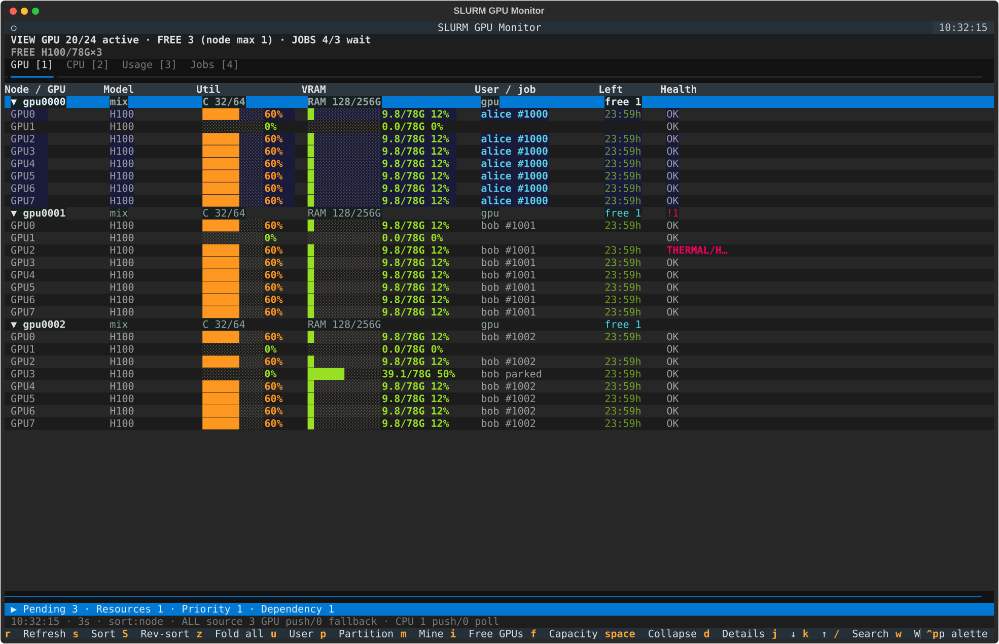

# sgpu

Rust로 구현한 Slurm GPU 운영 모니터입니다. GPU·CPU·Usage·Jobs TUI,
독립 노드 publisher, collector, 사용량 집계, Slack 알림과 Prometheus
textfile 출력을 제공합니다.

[English](README.md) · [노드 설치](docs/PUSH.md) · [Slack](docs/ALERTS.md) · [메트릭](docs/METRICS.md)



## 데이터 흐름

```text
노드 sgpu-agent --mode gpu ── 3초 ─┐
노드 sgpu-agent --mode cpu ──20초 ─┴─> 공유 <AGENT_DIR>/<hostname>.json
                                                    ↓
마스터: 로컬 Slurm 명령 + 공유 파일 ──> sgpu-collector ──> data.json / metrics.prom
                                                            ↓
                                                          sgpu TUI
```

노드는 자체 서비스로 수집 결과를 게시합니다. 결과가 없거나 오래됐거나
작성자를 신뢰할 수 없으면 관측 불가로 표시하고 GPU 재고만 유지합니다.
마스터에서 노드 수집·재시작·설치·복구를 요청하는 경로는 없습니다.
작업 취소는 Slurm controller를 통해 처리합니다.

## 빌드와 설치

main의 Rust 버전을 curl로 설치합니다.

```bash
# 마스터에서 실행: 모든 노드와 공유하는 게시 경로를 지정합니다.
curl -fsSL https://raw.githubusercontent.com/eightmm/slurm-gpu-tui/main/bootstrap.sh \
  | SLURM_GPU_TUI_AGENT_DIR=/nfs/sgpu-nodes bash -s -- --role master

# 각 GPU 노드에서 직접 실행합니다.
curl -fsSL https://raw.githubusercontent.com/eightmm/slurm-gpu-tui/main/bootstrap.sh \
  | SLURM_GPU_TUI_AGENT_DIR=/nfs/sgpu-nodes bash -s -- --role node --mode gpu
# CPU 전용 노드는 --mode cpu. 시스템 서비스는 bash 쪽을 root로 실행합니다.
```

Linux·git·C 컴파일러/linker가 필요합니다. 적절한 Rust가 없으면
[공식 rustup](https://rust-lang.github.io/rustup/installation/index.html)으로
최소 Rust 1.93.0 도구를 준비하고, 고정된 의존성을 빌드해 설치합니다.
첫 빌드는 수 분 걸릴 수 있습니다. `SGPU_INSTALL_RUST=0`으로 Rust 자동
설치를 끕니다. 소스 경로는 `SGPU_SOURCE_DIR`(기본 `~/.sgpu/source`)이며,
로컬 수정은 보존합니다. `SGPU_FORCE_UPDATE=1`일 때만 tracked 수정을
버리고 갱신하며, 기존 체크아웃은 fast-forward가 가능해야 합니다.
같은 curl 명령으로 해당 호스트의 역할을 업그레이드합니다.
`--no-build`와 `SGPU_BIN_DIR`로 호환되는 실행 파일을 제공하면 빌드 도구는
필요하지 않습니다.

기존 체크아웃에서 직접 빌드할 수도 있습니다.

빌드에는 Linux와 Rust 1.93 이상이 필요합니다. 실행 호스트에는 Rust가
필요하지 않습니다. 미리 빌드한 실행 파일은 대상 CPU 아키텍처와 시스템
C 라이브러리에 맞아야 합니다. 마스터는 `sinfo`, `squeue`, `scontrol`,
히스토리·백필에는 `sacct`, GPU 노드에는 `nvidia-smi`가 필요합니다.

```bash
cargo build --release --locked --bins -j 2

# 마스터에서 실행: 모든 노드와 공유하는 publisher 경로를 지정합니다.
SLURM_GPU_TUI_AGENT_DIR=/nfs/sgpu-nodes bash install.sh --no-build --role master

# 각 GPU 노드에서 직접 실행합니다. 실행 파일은 해당 호스트에 준비합니다.
SLURM_GPU_TUI_AGENT_DIR=/nfs/sgpu-nodes bash install.sh --no-build --role node --mode gpu
# CPU 전용 노드는 --mode cpu
```

`SGPU_BIN_DIR`로 다섯 실행 파일(`sgpu`, `sgpu-agent`, `sgpu-collector`,
`chkgpu`, `sgpu-install`)이 있는 디렉터리를 선택합니다. 기본 설치 위치는
root `/opt/sgpu`, 일반 사용자 `~/.sgpu/app`이며 `--prefix` 또는
`SGPU_INSTALL_DIR`로 변경합니다. 기존 설치를 업그레이드할 때는 기존
prefix와 DATA_DIR·STATE_DIR·AGENT_DIR를 명시적으로 재사용합니다.
노드 서비스도 각 노드에서 업그레이드해야 합니다.

root는 시스템 서비스와 `/usr/local/bin` 링크를 설치합니다. 일반 사용자는
사용 가능한 systemd user 서비스, 그 외에는 백그라운드 프로세스를 사용하고
`~/.profile`에 PATH를 추가합니다. user 서비스 수명은 사이트의 로그인·linger
정책을 따릅니다. `--no-service`는 파일·unit만 준비하고 서비스·PATH·공유
디렉터리를 변경하지 않습니다.

업그레이드는 새 release를 만든 뒤 `current` 링크를 원자적으로 바꿉니다.
실패하면 이전 파일·서비스 상태 복구를 시도하고 복구 오류도 보고합니다.
이전 release와 영속 데이터는 보존합니다. 개발 체크아웃의
`bash deploy.sh [설치 옵션]`는 필수 검증 후 현재 호스트에 설치합니다.

root 마스터 설치는 로그 tail과 정제된 작업 상세를 기본 공개합니다.
`SGPU_SHARE_LOGS=0`, `SGPU_SHARE_JOB_DETAILS=0`으로 해제하며 스크립트는
`SGPU_SHARE_SCRIPTS=1`로 선택합니다. 로그와 스크립트에는 비밀이 들어갈 수
있으므로 모든 독자가 해당 내용을 볼 권한이 있을 때만 공개합니다.
원본 로그 경로는 snapshot에 기록하지 않고, 검증된 scheduler 숫자 UID와
일반 파일 소유자를 확인합니다. root reader는 로그 소유자로 권한을 낮춥니다.

root GPU 노드 설치는 로컬 NVIDIA persistence mode도 활성화합니다.
`SGPU_ENABLE_PERSISTENCE=0`으로 생략합니다. 전력 확인은 해당 노드에서
`bash setup-node-power.sh --check`, 설치·모듈 설정은 root로
`bash setup-node-power.sh --apply`를 실행합니다.

제거도 역할별로 해당 호스트에서 실행합니다.

```bash
bash uninstall.sh --role master
bash uninstall.sh --role node
```

사용량·설정·export·공유 payload·이전 release는 보존합니다. 파일만 설치한
경우 제거에도 `--no-service`를 사용합니다.

## 사용법

`sgpu`로 화면을 엽니다. `docs/` 스크린샷은 합성 데이터이며 실제 배치는
터미널 너비에 따라 달라집니다.

| 키 | 동작 |
|---|---|
| `1` / `2` / `3` / `4` | GPU / CPU / Usage / Jobs |
| `j` / `k`, 화살표, PageUp / PageDown | 이동·스크롤 |
| `s` / `S` | 정렬 순환·역순 |
| `u` / `p` / `m` / `i` | 사용자·파티션·내 작업·빈 GPU 필터 |
| `/`, `Esc` | 검색·초기화 |
| Space / `z` | 노드 하나·전체 접기 |
| `d` / `v` / `t` | 상세 열·대기 목록·5분 추세 |
| Enter, Tab / Shift+Tab | 상세 열기·Info/Script/StdOut/StdErr 전환 |
| `w` / `f` / `h` | 낭비·가용량·내 작업 히스토리 |
| `n` / `x` | 작업 전환 watch·본인 작업 취소 확인 |
| `e` / `r` / `?` / `q` | JSON export·새로고침·도움말·종료 |

```bash
sgpu once                       # --once 등 기존 별칭도 지원
sgpu json
sgpu waste -v                   # 낭비가 있으면 exit 1
sgpu me
sgpu usage 7 --daily
sgpu jobs 7 --user alice
sgpu report 2026-11
sgpu logs 12345 -e -f
sgpu wait-free 2 --partition gpu
sgpu fit 2 --model h100 --vram 40 --cpus 16 --ram 64 --explain
sgpu doctor
chkgpu
sgpu bench --nodes 128 --repeat 5
sgpu bench --replay snapshot.json
```

VRAM·RAM 입력은 GiB입니다. fit은 정확한 Slurm GRES 타입과 정규화한
하드웨어 이름, scheduler CPU·RAM 할당량과 신선한 GPU 관측을 사용합니다.
예약·QOS·scheduler 정책은 별도로 적용됩니다. `?`는 결측, `~`는 부분 관측이며
미지원 지표는 누락으로 남습니다. GPU-hours 할당량은 sampled·sacct 중 큰 값,
효율 분모는 관측한 할당량입니다. cgroup 메모리는 cache·하위 cgroup을 포함하며
노드별 peak 합이 동일 시점 전체 peak는 아닙니다. 대기 시작 시각은 추정입니다.

오프라인 bench는 모델 갱신과 터미널 버퍼 렌더링을 함께 측정하고 JSON 해석은
제외합니다. 단일 snapshot·배열·`{"snapshots": [...]}`를 최대 64 MiB까지 읽고
scheduler·네트워크를 호출하지 않습니다. 과거 UI의 갱신 전용 수치와 직접
비교할 수 없습니다.

## 설정과 운영

환경변수 전체 기본값은 [English 설정 표](README.md#configuration-and-operations)에
정리했습니다. 설치 시 지원하는 공개 설정만 unit에 기록하고 Slack 토큰은
별도 비공개 설정에 둡니다. 핵심 경로는 다음과 같습니다.

| 환경변수 | 기본값 |
|---|---|
| `SLURM_GPU_TUI_DATA_DIR` | `/tmp/slurm-gpu-tui` |
| `SLURM_GPU_TUI_STATE_DIR` | root `/var/lib/sgpu`; 일반 사용자 `~/.sgpu/state` |
| `SLURM_GPU_TUI_AGENT_DIR` | `~/.sgpu/nodes`; 운영 시 공유 절대 경로 지정 |
| `SLURM_GPU_TUI_AGENT_RUNTIME_DIR` | root `/run`, 일반 사용자 임시 경로; 로컬 lock/log 격리 가능 |
| `SLURM_GPU_TUI_SLACK_CONFIG` | root `/etc/sgpu/slack.json`, 사용자 `~/.sgpu/slack.json`; 이전 경로도 검색 |

`sgpu doctor`로 snapshot·scheduler·publisher 신뢰·Slack 상태를 확인합니다.
마스터에서는 `systemctl status sgpu-collector`, 노드에서는
`systemctl status sgpu-agent`와 각 서비스의 `journalctl -u ... -f`를 확인합니다.
user 서비스는 `--user`를 붙입니다. 백그라운드 로그는
`<DATA_DIR>/collector.log`와 agent runtime `.log`입니다. stale 노드는
해당 노드에서 서비스·공유 mount·쓰기 권한을 확인합니다.

## 검증

`bash scripts/check.sh`는 rustfmt·엄격한 clippy·Rust unit/integration 테스트·
Bash 문법·ShellCheck·오프라인 benchmark를 실행합니다. 테스트는 경로를
임시 디렉터리로 격리하고 scheduler 명령을 대체합니다. CI는 PR·수동 실행 시
Linux/Rust 1.93 작업 하나만 실행합니다. 실제 GPU·Slack·root 서비스·운영 NFS는
사이트 환경에서 별도 검증해야 합니다.
