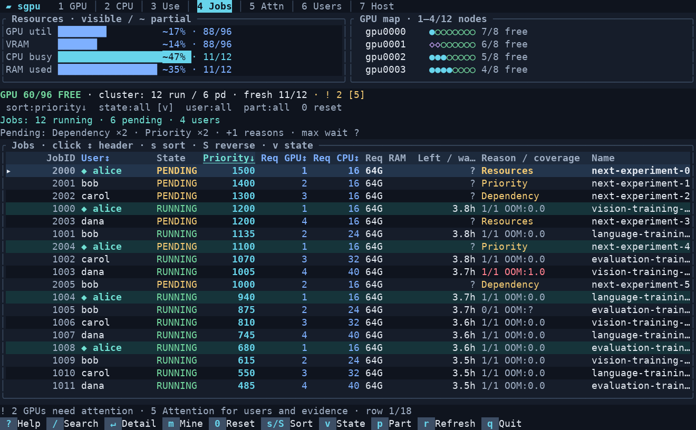
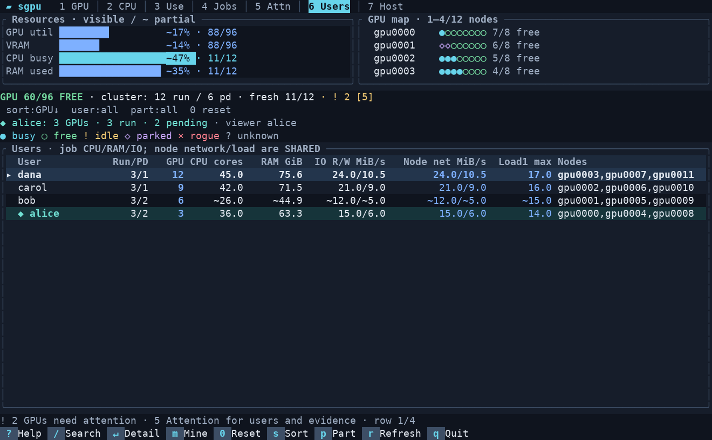
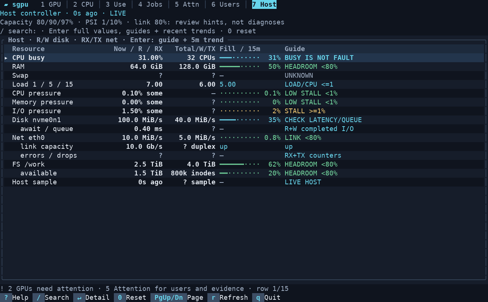
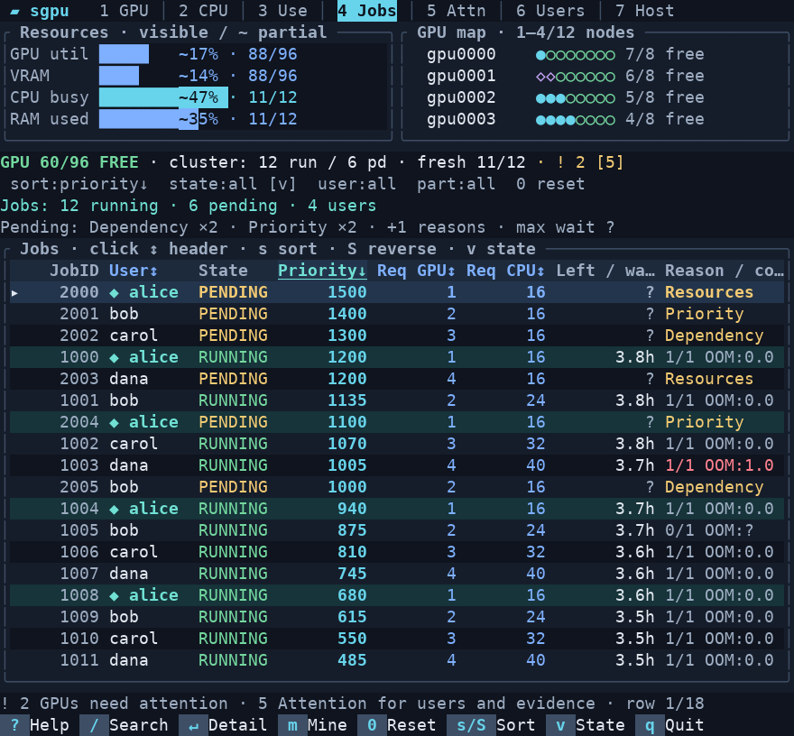

<div align="center">

# sgpu

**Slurm GPU 클러스터를 터미널에서 한눈에.**

작업·GPU 낭비·사용량·알림을 함께 확인하는 Rust 모니터입니다.

[](https://github.com/eightmm/slurm-gpu-tui/actions/workflows/test.yml)
[](https://github.com/eightmm/slurm-gpu-tui/blob/main/Cargo.toml)
[](https://github.com/eightmm/slurm-gpu-tui#build-and-install)
[](https://github.com/eightmm/slurm-gpu-tui/stargazers)

[화면 예시](#화면-예시) · [설치](#build-and-install) · [사용법](#사용법) · [Slack 알림](ALERTS.md) · [English](../README.md)

</div>

## 주요 기능

| 기능 | 제공 내용 |
|---|---|
| **클러스터 상태** | GPU·CPU·RAM 실시간 막대, 노드별 GPU 상태 지도, 키보드로 탐색하는 작업 표 |
| **사용자와 컨트롤러** | 작업별 사용량, 주의할 GPU 사용자 그룹, 컨트롤러 I/O·파일시스템·사용 가능한 quota |
| **낭비 탐지와 집계** | idle·parked·rogue GPU 탐지와 사용자별 GPU-hours |
| **작업 들여다보기** | 이력·스크립트·로그와 본인 작업 취소 확인 |
| **화면 밖에서도 알림** | Slack 일별 스레드, 소유자 전용 실패 DM, Prometheus textfile |
| **노드가 결과 게시** | 독립 publisher로 수집하며, 결측·stale을 가용량과 구분 |

## 화면 예시

예시 데이터로 렌더링한 120열 화면입니다. 아래에는 80열 Jobs 화면도 포함했습니다.

**Jobs** — 클릭 정렬 헤더, 사용자 강조와 대기 이유를 함께 보여줍니다.



<details>
<summary>GPU 대시보드</summary>

자원 막대, 노드별 상태 지도와 GPU별 관측값을 확인합니다.


</details>

<details>
<summary>사용자별 자원과 공유 노드 지표</summary>

작업에 귀속되는 CPU·RAM·I/O와 노드 공용 network·load를 구분합니다.



</details>

<details>
<summary>컨트롤러 Host</summary>

CPU·메모리·pressure, 디스크·네트워크 처리량과 파일시스템 용량을 해석 기준과 함께 보여줍니다.



</details>

<details>
<summary>80열 터미널의 Jobs</summary>

좁은 화면에서도 priority, GPU·CPU 요청과 대기 이유를 유지합니다.



</details>

## Build and install

```bash
curl -fsSL https://raw.githubusercontent.com/eightmm/slurm-gpu-tui/refs/heads/main/bootstrap.sh | sudo bash
```

마스터에 root 권한으로 설치합니다. Linux·git·C 컴파일러가 필요하며, Rust가
없으면 설치기가 준비합니다. 첫 빌드는 수 분 걸릴 수 있습니다. 다시 실행하면
업그레이드하며, 기존 설치 경로·서비스 설정·상태·Slack 설정은 유지합니다.
설치 후 `sgpu --version`으로 **2.3.0**인지 확인할 수 있습니다. 일반 사용자는
`sgpu`만 실행하면 됩니다.

각 노드의 publisher와 공유 디렉터리는 [노드 설정](PUSH.md)을 따릅니다.
노드가 공유 파일시스템에 결과를 게시하고 마스터가 읽습니다. 마스터에서
노드에 원격 접속하지 않습니다. 2.2.0 이상을 한 번 설치한 노드는 이후
마스터 업그레이드 시 게시되는 새 agent를 자동으로 받아 적용하며 실패 시 복구합니다.
이전 agent는 각 노드에서 한 번 업데이트해야 합니다.
[자동 업데이트 조건](PUSH.md#automatic-agent-updates)을 확인하세요.

## 사용법

```bash
sgpu                    # GPU / CPU / Usage / Jobs / Attention / Users / Controller
sgpu --highlight-user alice  # 관리자 화면에서 특정 사용자 강조
sgpu once               # 현재 상태
sgpu me                 # 내 작업·낭비·사용량
sgpu waste -v           # 낭비 GPU
sgpu usage 7 --daily     # GPU-hours
sgpu jobs 7              # 작업 이력
sgpu logs 12345 -e -f    # stderr 따라가기
sgpu doctor             # 수집·설정 진단
sgpu host               # 게시된 컨트롤러 자원·디스크·파일시스템
sgpu users              # 게시된 사용자별 자원과 공유 노드 카운터
chkgpu                  # 사용자 × 노드 할당량
chkgpu --summary        # 노드별 여유 자원·사용 불가 상태·대기 이유
```

| 키 | 동작 |
|---|---|
| `1`–`7` | GPU / CPU / Usage / Jobs / Attention / Users / Controller |
| `u` / `p` / `m` / `i` | 사용자 / 파티션 / 강조한 사용자 / 빈 GPU 필터 |
| `[` / `]` / `0` | 이전 노드 / 다음 노드 / 필터 초기화 |
| `/` / `s` / `S` | 검색 / 정렬 / 역순 |
| Jobs에서 `v` | 전체 / 실행 / 대기 작업 |
| Enter / Tab | 상세 열기 / 정보·스크립트·로그 탭 전환 |
| `w` / `f` / `h` | 낭비 / 가용량 / 작업 이력 |
| `n` / `x` | 작업 watch / 본인 작업 취소 확인 |
| `?` / `q` | 전체 도움말 / 종료 |

`sgpu`는 자원 막대·GPU 상태 기호·정렬 가능한 표를 갖춘 대시보드를 엽니다.
`chkgpu`는 터미널에서 자동으로 색상을 쓰고 파이프 출력에서는 제거합니다.
`--color always`, `--color never`로 지정하거나 `NO_COLOR`로 끌 수 있습니다.
`chkgpu --summary`는 행렬 대신 노드 상태, GPU 할당·미할당 수, CPU idle 수,
사용 불가 이유와 대기 이유별 개수·최장 대기 시간을 보여줍니다. CPU 수는 `sinfo`를
사용하며 결측은 `?`, 사용 불가·상태 불명 노드의 여유량은 `—`로 표시합니다.
`COMPLETING` 작업도 할당에 포함하며 기본 행렬에도 대기 이유 요약을 추가했습니다.
Slurm 조회는 기존과 같은 세 번이며 compute node에 접속하지 않습니다.
여유량은 scheduler 카운터 기준으로 실행 승인을 보장하지 않으며 다음 종료 예상은
작업 제한 시간 기준입니다. 다중 노드 작업의 사용자별 CPU 분배는 추정값입니다.
`sgpu host`, `sgpu users`는 해당 자원 화면을 단발 출력합니다. 최신 collector
snapshot이 필요하며 UI를 실행한 컴퓨터의 측정값으로 대체하지 않습니다.
사용자별 network/load는 공유 노드 값이며 미지원 지표는 결측으로 남깁니다.

**Jobs**에서 `s`로 priority·사용자·요청 GPU·요청 CPU·대기 시간·남은 시간을
순환 정렬하고 `S`로 방향을 바꿉니다. Priority는 높은 점수부터, 사용자별 묶음은
이름순으로 표시하고 묶음 안에서는 높은 priority부터 보여줍니다. 결측값은 양쪽
방향 모두 뒤에 둡니다. `v`로 전체/실행/대기를 전환하고 `0`으로 필터를 초기화합니다.
요약에는 현재 필터에 맞는 실행·대기 작업 수와 사용자 수, 주요 대기 이유와 최장 대기 시간이
표시됩니다. 검색은 partition과 QOS도 찾으며, 좁은 화면에도 priority와 대기 이유를
남기고 여유가 있으면 CPU cores와 RAM/VRAM GiB 열을 표시합니다. 새로고침이나
탭 이동 후에도 Jobs 정렬 설정을 유지합니다. Priority는 Slurm 점수이며 실행 순번을
보장하지 않습니다. 남은 시간은 작업 제한 시간 기준이며 GPU 요청은 노드당 GRES,
CPU 요청은 작업 전체 기준입니다. 실행 작업의 priority가
없는 이전 snapshot은 `?`로 표시합니다.
Jobs의 **User**, **Priority**, **Req GPU**, **Req CPU** 헤더를 클릭해 바로
정렬하고 같은 헤더를 다시 클릭하면 방향을 바꿉니다. 헤더의 화살표로 클릭 가능
여부와 현재 방향을 표시합니다. 마우스 휠로 표와 상세 화면을 스크롤할 수 있습니다.
표와 팝업은 대비가 높은 어두운 팔레트를 공유합니다. 선택 행·본인 계정·현재 정렬
헤더를 다르게 강조하고, 상태와 주요 자원 값에 색을 집중합니다. Jobs·Users·Attention은
대시보드 높이를 줄여 목록을 더 많이 보여줍니다.

본인 작업은 청록색 배경과 `◆`로 강조하며 선택 커서와 구분합니다.
Util은 활동량에 따라 회색·파랑·청록·초록, VRAM은 포화도에 따라
파랑·청록·노랑·주황·빨강을 사용합니다. 큰 터미널에서는 막대도 굵어집니다.
`--highlight-user`는 표시·필터만 바꾸며, 취소·비공개 로그 권한은 실행 계정을 따릅니다.

Users는 작업에 귀속되는 CPU·RAM·block I/O와 노드 공용 네트워크·load를 구분합니다.
Controller는 컨트롤러의 CPU·RAM·load·물리 디스크·NIC·파일시스템과 사용 가능한
사용자 quota를 표시합니다. Attention은 현재 관측으로 확인한 idle·parked·미할당
GPU를 사용자별로 모으고 근거를 제공합니다. Slack 알림은 기존 임계값을 유지합니다.
Host 탭은 R/W·RX/TX를 정렬하고 용량을 TiB까지 자동 변환합니다. PSI·디스크
대기시간/큐·링크 용량·inode를 함께 표시하며, Enter로 해석 기준과 최근 5분
추이를 확인합니다. 색상 임계값은 점검을 돕는 기준이며 높은 처리량만으로
이상을 판정하지 않습니다. 자동 업데이트를 준비한 노드는 업그레이드를 받고,
이전 publisher는 안내에 따라 한 번 현지에서 업데이트해야 합니다.
[수집 범위와 귀속 기준](PUSH.md#resource-views)을 함께 확인하세요.

`?`는 결측, `~`는 부분 관측입니다. 오래된 데이터는 빈 GPU로 계산하지 않으며,
가용량과 대기 시작 시각은 scheduler의 실행 승인을 보장하지 않습니다.

## 알림과 운영

[Slack 알림](ALERTS.md)은 유지됩니다. 일별 스레드, 장애·복구·낭비·GPU
건강 알림과 소유자에게만 전달하는 작업 실패 DM을 지원합니다. 토큰은 서버의
비공개 설정에 두며 저장소나 서비스 unit에 기록하지 않습니다.

root collector는 작업 로그와 정제된 상세를 기본 공개합니다. 클러스터 정책에
따라 `SGPU_SHARE_LOGS=0`, `SGPU_SHARE_JOB_DETAILS=0`으로 해제할 수 있고,
스크립트 공개는 선택 사항입니다. 로그·스크립트에는 민감한 내용이 들어갈 수
있으므로 공개 범위를 확인하세요.

- [노드 설치·설정·업그레이드](PUSH.md)
- [Slack 설정과 알림 종류](ALERTS.md)
- [Prometheus 메트릭](METRICS.md)

운영 스크립트는 `scripts/`, 구현은 `src/`, 검증은 `tests/`에 모았습니다.
`bash scripts/check.sh`로 형식·clippy·테스트·쉘 검사를 실행합니다.

## 프로젝트 응원하기

클러스터 운영에 도움이 됐다면 [Star](https://github.com/eightmm/slurm-gpu-tui)를
눌러 저장해 두세요. 버그 제보는 [Issues](https://github.com/eightmm/slurm-gpu-tui/issues),
개선 사항은 [Pull requests](https://github.com/eightmm/slurm-gpu-tui/pulls)로 받습니다.
