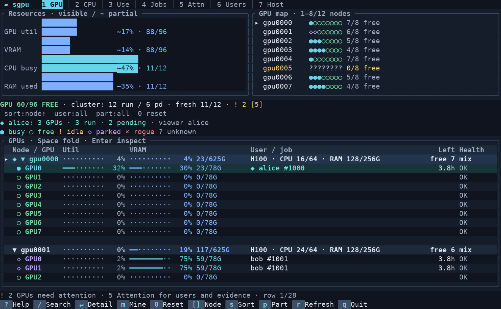

<div align="center">

# Oh My Slurm

**Slurm 클러스터의 모니터링·진단·일상 작업을 한곳에서.**

GPU · CPU · RAM · 작업 · 사용자 · 알림

[](https://github.com/eightmm/oh-my-slurm/actions/workflows/test.yml)
[](https://github.com/eightmm/oh-my-slurm/blob/main/Cargo.toml)
[](#build-and-install)

[화면](#화면-예시) · [설치](#build-and-install) · [사용법](#사용법) · [가이드](#가이드) · [English](../README.md)

</div>

기존 `slurm-gpu-tui`에서 이름을 바꾼 독립 커뮤니티 도구입니다.
대시보드 `sgpu`와 기존 `chk*` 명령·설정·설치 경로는 그대로 호환됩니다.

| 클러스터 현황 | 작업 확인 | 운영 지원 |
|---|---|---|
| 실시간 자원 막대·노드 지도·여유량 | Priority 정렬·사용자별 보기·로그·본인 작업 취소 | GPU 낭비·사용 이력·Slack 알림·Prometheus 지표 |

## 화면 예시


*예시 데이터로 렌더링한 120열 화면입니다.*

<details>
<summary>다른 화면: GPU · Users · Host · 80열 Jobs</summary>




</details>

## Build and install

```bash
curl -fsSL https://raw.githubusercontent.com/eightmm/oh-my-slurm/refs/heads/main/bootstrap.sh | sudo bash
```

마스터에서 root로 실행합니다. Linux·git·C 컴파일러가 필요하며 Rust는 필요 시
준비합니다. 다시 실행하면 기존 경로·상태·Slack 설정을 유지하며 업그레이드합니다.
일반 사용자는 `sgpu`를 실행하면 됩니다.

각 노드는 공유 파일시스템에 결과를 게시합니다. [노드 설정 가이드](PUSH.md)를 따라
설치하면 호환되는 agent는 이후 [자동 업데이트](PUSH.md#automatic-agent-updates)를 받습니다.

## 사용법

```bash
sgpu                    # 대화형 대시보드
chkgpu                  # 사용자 × 노드 할당 행렬
chkgpu --summary        # 노드 여유량과 대기 이유
chkqueue --mine         # 내 대기 작업의 priority·대기 시간·이유
chkfail                 # 최근 24시간에 끝난 내 실패·중단 작업
sgpu explain 12345      # 대기 사실·해석·노드 여유량
sgpu me                 # 내 작업·사용량
sgpu users              # 사용자별 자원
sgpu host               # 컨트롤러 자원
sgpu usage 7 --daily     # GPU-hours
sgpu logs 12345 -e -f    # stderr 따라가기
sgpu doctor             # 수집 상태 진단
sgpu welcome            # 게시된 데이터로 짧은 로그인 요약
```

| 조작 | 동작 |
|---|---|
| `1`–`7` | GPU / CPU / Usage / Jobs / Attention / Users / Host |
| `↕` 클릭 · `s` / `S` | Jobs 헤더 정렬 · 정렬 순환 / 역순 |
| `u` / `p` / `m` | 사용자 / 파티션 / 강조한 계정 필터 |
| `U` / `P` | 사용자 / 파티션을 검색해서 선택 |
| `E` / `F` | 선택한 대기 작업 설명 / 내 24시간 실패 요약 |
| Jobs에서 `v` | 전체 / 실행 / 대기 |
| `/` / `0` | 검색 / 필터 초기화 |
| Enter / Tab | 상세 / 스크립트·로그 탭 |
| 우클릭 / `a` | Actions 메뉴: 클릭 또는 방향키 + Enter |
| `J` / Esc | GPU·CPU·Users·Attention에서 관련 Jobs / 이전 화면 |
| `?` / `q` | 전체 도움말 / 종료 |

전체 명령은 `sgpu --help`에서 확인합니다. `sgpu --highlight-user alice`로 계정을
강조할 수 있으며 권한은 실행 계정을 따릅니다. 세 `chk*` 명령은 공통으로
`--color auto|always|never`와 `NO_COLOR`를 지원하며 파이프에서는 기본으로 색을 끕니다.
청록 제목 · 초록 본인/이상 없음 · 노랑 대기/중단 · 빨강 실패/할당 포화 · 회색 보조 정보로 통일했습니다.
JSON에는 `--color always`에서도 색상 코드를 넣지 않습니다.

마지막 탭·정렬·Jobs 상태는 `~/.sgpu/ui/preferences.json`에 저장합니다.
검색어·계정 필터·로그·임시 관련 화면은 현재 세션에만 유지합니다.

탭·행·정렬 표시가 있는 헤더·필터·버튼을 클릭할 수 있습니다.
행 선택 후 **Detail**을 누르세요. 짧은 창에서는 상세가 화면 전체로 확장되며,
휠·페이지 버튼으로 스크롤하고 **Follow**로 실시간 로그 따라가기를 재개합니다.
상세·로그에서 `/`로 문자열을 찾고 `n` / `N`으로 일치하는 줄을 이동합니다.
Enter로 검색을 적용하며, Esc는 검색 입력을 지운 뒤 팝업을 닫습니다.

`chkqueue` = `sgpu queue` (`--mine`, `--partition`, `--limit`, `--json`).
`chkfail` = `sgpu failures` (`--hours 24`, `--json`): 본인 accounting만 한 번 조회하고
UTC 종료 시각으로 집계합니다. 취소·선점은 구분하며 작업 step은 집계에서 제외합니다.
Slurm 19.05 이상에서 `sacct --array` 없이 동작하며 묶인 배열 작업은 개별 task로 풀어서 집계합니다.

`?`는 결측, `~`는 부분 관측입니다. 오래된 데이터는 빈 자원으로 계산하지 않습니다.
GPU Health의 `CAP`은 전력 상한에 따른 클록 조절이며, 단독으로는 장애 표시가 아닙니다.
Users의 network/load는 노드 공용 값이며 priority·여유량·예상 시작 시각은 실행 승인을
보장하지 않습니다. 자세한 기준은 [지표 해석](PUSH.md#resource-views)을 참고하세요.

## 가이드

| 가이드 | 내용 |
|---|---|
| [노드 설정·업그레이드](PUSH.md) | 공유 경로·서비스·설정·문제 해결 |
| [로그인 요약](LOGIN.md) | 공용·개인 요약과 선택적 MOTD 연결 |
| [혼합 클러스터 호환성](COMPATIBILITY.md) | Slurm 버전·GPU/드라이버 폴백·네이티브 바이너리 범위 |
| [성능 검사](PERFORMANCE.md) | 스냅샷 재생·대규모 대기열 벤치마크 |
| [Slack 알림](ALERTS.md) | Bot 설정·일별 스레드·소유자 DM |
| [Prometheus 지표](METRICS.md) | Textfile 출력·알림 규칙 |

설치 기본값은 작업 로그 tail과 정제된 상세를 snapshot 독자에게 공개합니다.
`SGPU_SHARE_LOGS=0` / `SGPU_SHARE_JOB_DETAILS=0`으로 끌 수 있으며 스크립트는 선택 공개입니다.

검사: `bash scripts/check.sh` · [버그 제보](https://github.com/eightmm/oh-my-slurm/issues) · [기여](https://github.com/eightmm/oh-my-slurm/pulls) · [Star](https://github.com/eightmm/oh-my-slurm/stargazers)
